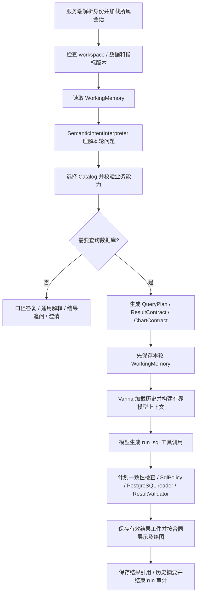

# 分析上下文与记忆 v2：Phase 0–2 代码基线

核对日期：2026-10-15。Phase 1 完成 ConversationHistory 与 AnalysisState；Phase 2 增加逐次执行证据和可信结果复用，详见文末。目标设计与后续任务统一见 [实施计划](../../plan/architecture-analysis-context-memory-v2.md)。本文件回答“现在实际上怎样工作”，计划回答“接下来怎样改”。

## 1. 本阶段任务卡

| 项目 | 范围 |
| --- | --- |
| 目标 | 完成 Phase 0 基线、Phase 1 active state/ConversationHistory 和 Phase 2 执行证据及结果复用 |
| 输入 | 当前 Web 装配、ChatHandler、语义解释器、WorkingMemory、会话存储、摘要过滤器、执行审计及结果工件代码 |
| 输出 | 本基线、Phase 1/2 代码与测试证据、项目记录与文档导航 |
| 不变量 | 不恢复关键词准入；不改变模型、权限、SQL/结果校验、查询预算及离线训练评测协议 |
| 验收 | 对照函数调用和数据库字段核对；运行现有相关回归，单独运行项目数据库会话存储测试 |
| 非目标 | Phase 0/1 未实现 ExecutionMemory，现已在 Phase 2 补充；ReferenceBinding 和跨会话长期记忆仍未实现 |

## 2. 当前在线调用顺序

`examples/trusted_olist_web_demo.py:create_app()` 在服务启动时构造会话存储、Catalog、SQL runner、Agent 和 `BudgetedChatHandler`，并明确注入 `SemanticIntentInterpreter`。每个正常分析请求按以下顺序运行：



这是正常链路；解析失败、SQL 拒绝、空结果、超预算和状态冲突分别有分支，不能认为每个请求都会到达最后一步。`/help` 等 workflow 命令保留 Vanna 自身入口。

有两个不同的模型上下文入口，当前不能混为一谈：

- **语义解释调用**在 Vanna 主对话之前发生，只接收当前问题、可用 Catalog 指标及部分 WorkingMemory；没有接入近期聊天原文、HistorySummary 或结果实体行。
- **Vanna 主对话调用**由 `Agent._build_llm_request()` 从会话消息经 `ContextBudgetFilter` 构造。它能看到近期完整 turns，`CatalogContextEnhancer` 还加入本轮 Catalog、计划及结构化状态。按“语义理解 / SQL 生成 / 回答”分别构建 history projection、统一剥离历史工具 SQL 仍是后续工作。

`candidate_sql_generator.py` 的运行时请求构造器在 Handler 中生成候选组件的对齐证据，不代表默认在线 Provider 已被独立的 SQL-only 小模型替换。

## 3. 组件入口、输入输出与持久化

| 当前代码入口 | 输入 → 输出 | 更新触发与保存位置 | 失败边界 / 尚缺内容 |
| --- | --- | --- | --- |
| `chat_runtime.py:BudgetedChatHandler.handle_stream()` | ChatRequest + 认证用户 + 会话 → 路由结果、查询计划、SSE | 请求前创建所属会话及 run；计划生成后保存 canonical state；主对话后保存结果引用 | 处理 stale state 冲突；ExecutionMemory 独立视图仍待 Phase 2 |
| `conversation_store.py:PostgresConversationStore._get_sync()` | conversation ID + 用户 + workspace → Conversation 与完整消息；另提供近期完整 turn 读取 | 从 `app.conversations`、`app.messages` 读取，按 message_index 排序；消息 metadata 带 message/turn 关联 | 不返回他人/其他 workspace 会话；结果实体引用仍待后续实现 |
| `conversation_store.py:_update_sync()` | Conversation 或增量消息 → 事务提交与 state_version + 1 | 复用既有 message 主键/index，增量追加不重复历史；metadata 写入 working_memory JSONB | `FOR UPDATE` + 版本比对；拒绝归属/版本冲突。禁止 silent last-write-wins |
| `semantic_intent.py:SemanticIntentInterpreter.interpret()` / `prompt()` | 当前问题 + 角色可见 Catalog + state → 类型化 SemanticIntent | 无独立记忆写入；Handler 记录到本轮 trace | Provider 异常最多重试一次；JSON/字段/角色校验失败不给 SQL 权限。只收到结果存在布尔值，没有实际实体引用 |
| `semantic_intent.py:select_intent_catalog()` / `route_semantic_intent()` | SemanticIntent + Catalog + 当前 state → CatalogSelection / QuestionRoute | 不独立持久化 | 校验指标、维度、归属、筛选和预算；当前额外筛选只支持一个两字母大写客户州，不支持任意条件编译 |
| `working_memory.py:WorkingMemory.from_mapping()` / `as_dict()` | 旧字段 ↔ `AnalysisState` 兼容映射 | `conversation.metadata['working_memory']`，最终进 conversations JSONB | `AnalysisState` 是唯一 active state 权威；WorkingMemory 不再与其双写竞争 |
| `chat_runtime.py` 中语义分支的 state patch | 本轮 SemanticIntent → 增量 patch 后的 canonical state | SQL 执行之前保存；澄清时更新 pending_question/pending_missing | patch 只接受 Catalog/QueryPlan 能表达的字段；旧结果与新计划通过 task/turn 边界区分 |
| `analysis_lifecycle.py:prepare_turn_memory()` / `clear_active_analysis_state()` | Conversation + 当前 workspace → 可复用 state 或新 task | 版本漂移和手动清空都隔离 active task；历史与审计保留 | 清空不自动恢复旧条件；结果工件只挂到对应成功 turn |
| `context_builder.py:ContextBudgetFilter.filter_messages()` | 主对话全部消息 → 近期完整轮次及省略边界/可选语义摘要 | 在构建 Vanna LLM 请求时运行；按 source digest 使用进程内缓存 | 摘要失败返回 provenance 边界；超大当前轮次有压缩分支，不能等同所有极端预算下工具配对已验证 |
| `history_summary.py:HistorySummary` / `build_llm_summary_provider()` | 省略前缀 turns → 来源证据和可选自然语言摘要 | Handler `_persist_history_summary()` 保存到 metadata；Store 写入 `working_memory.__history_summary` | 压缩器未读持久摘要续接；summary_prompt 每消息最多 2,000 字符、总计最多 8,000 字符，但来源范围按整个省略区记录 |
| `run_recorder.py:PostgresRunRecorder.start()` / `finish()` | request、用户、版本、BudgetUsage → AgentRun 与审计结果 | `app.agent_runs` 保存一次请求；runner 的 SQL 审计通过 run_id/request_id 关联 | 已有执行证据基础，不是完整 task/state/execution 记忆；一个 run 可能含 SQL 重试，不能把 run_id 当成一次 SQL 尝试 ID |
| `trusted_sql_tool.py:TrustedRunSqlTool.execute()` / `_remember_result_artifact()` | SQL 工具参数 + 计划/结果合同 → ToolResult 与工件指针 | 计划 guard → runner 的策略/执行/结果校验；只有 validation.state=valid 才保存完整结果 CSV | 不以工具 UI success 代替校验；受控 repair 有独立证据，不支持无限修复 |
| `result_artifact_store.py:ResultArtifactStore` | 有效结果与 scope → CSV/Plotly manifest；按 scope 回读 | 仓库外，按 user/workspace/artifact 隔离，保存版本、大小和完整性证据 | Store 校验 scope 和文件完整性，版本适用性由生命周期/调用方判断；没有可信结果实体/排序绑定接口 |
| `result_artifact.py:ResultArtifact.from_trusted_usage()` / Handler `_persist_result_artifact()` | 本轮可信摘要 + trace → 会话内结果引用 | 主对话后存入 canonical state 的 artifact 指针；图表另有历史引用 | 保存摘要、列、版本、CSV/图表指针；可信实体/排序 binding 仍待 Phase 3 |

关键阅读路径：

1. [Web 装配](../../examples/trusted_olist_web_demo.py) → [Handler](../../src/data_analysis_agent/chat_runtime.py)。
2. [语义解释与能力校验](../../src/data_analysis_agent/semantic_intent.py) → [WorkingMemory](../../src/data_analysis_agent/working_memory.py) → [生命周期](../../src/data_analysis_agent/analysis_lifecycle.py)。
3. [会话存储](../../src/data_analysis_agent/conversation_store.py) → [消息/会话 DDL](../../infra/postgres/security.sql) → [Vanna 主对话与上下文装配](../../src/vanna/core/agent/agent.py)。
4. [历史过滤](../../src/data_analysis_agent/context_builder.py) → [摘要](../../src/data_analysis_agent/history_summary.py) → [结果引用对象](../../src/data_analysis_agent/result_artifact.py) / [外部工件](../../src/data_analysis_agent/result_artifact_store.py)。

## 4. QuestionRouter 的保留职责

“去掉旧路由”指默认在线请求不再调用 `QuestionRouter.classify()`、`admit_sql_request()` 来解释自然语言，不代表删掉同名类的所有职责。

| 场景 | 当前行为 |
| --- | --- |
| `create_app()` 默认产品入口 | 注入 SemanticIntentInterpreter；语义成功走 `route_semantic_intent()`；失败返回澄清，不退回关键词准入 |
| 线上仍使用的 QuestionRouter 能力 | 持有 CatalogRetriever、资源参数，并提供口径/帮助格式化；确定性能力校验由 `route_semantic_intent()` 执行 |
| 未注入解释器的调用方和历史离线测试 | Handler 仍保留 classify/admit、关键词补全与 WorkingMemory.apply 兼容分支；不能据此描述默认在线产品 |
| 后续处理 | 按计划先理清职责，再决定拆类/命名；Phase 0 不删除兼容代码、不重写冻结离线协议 |

`tests/test_semantic_intent.py:test_handler_semantic_path_does_not_call_legacy_router` 将 classify、admit 和 WorkingMemory.apply 替换为抛错函数，验证语义查询、澄清和解析失败三条分支均不经过它们。该测试使用模型桩，证明调用关系，不证明真实模型理解率。

## 5. 统一术语及权威来源

| 名称 | 本方案中的固定含义 | 当前实现映射 | 后续边界 |
| --- | --- | --- | --- |
| ConversationHistory | 有序消息原文及完整 turns，是意图与对话脉络来源 | conversations/messages + 近期窗口/cursor 读取 + Vanna Conversation.messages | 原文不等于已执行事实；历史 SQL/tool projection 仍待 Phase 4 |
| AnalysisState | 一个 active task 当前想查询的结构化条件 | `analysis_state.py` + conversations JSONB，WorkingMemory 兼容映射 | Phase 1 已定义唯一 canonical state 和 patch；不双写两份权威状态 |
| ExecutionMemory | 每次执行尝试及验证结果的可追溯视图 | 现有 agent_runs、SQL 审计、BudgetUsage trace | Phase 2 补 task/state/plan/attempt/artifact 关联，复用现有审计，不另造日志系统 |
| ResultArtifact | 已验证执行产生的结果数据及引用 | 会话内 ResultArtifact 指针 + 仓库外 CSV/Plotly/manifest | Phase 2 增加排序和实体元数据；不是聊天文本或缓存命中即可可信 |
| ReferenceBinding | 将“这个州/上一轮第二名”解析到具体可信结果行/维度值的服务端绑定 | 尚无专用实现 | Phase 3 从 artifact 解析并验证，不从助手回答或摘要抽取结果值；用户显式条件仍可经正常校验进入 state |
| HistorySummary | 带来源范围的派生叙事摘要 | HistorySummary + 持久化 metadata | Phase 4 增量续接并按真实覆盖范围推进；不能覆盖 state 或充当执行证据 |
| ContextCompaction | 为一次模型调用裁剪近期窗口、压缩旧历史的过程 | ContextBudgetFilter + summary provider | 不删除原始历史，不等于长期记忆；现有本轮内部工具轨迹与历史投影需要区分 |
| Semantic Catalog | 服务端维护的指标口径、表列和维度能力 | CatalogLoader / CatalogRetriever | 继续按 workspace/version 加载；与暂缓的跨会话用户偏好记忆分开 |

`conversation_id` 是会话；`turn_id` 是用户一问及其后续处理；`task_id` 是一项分析任务；`run_id` 是一次请求运行；`execution_id` 是一次 SQL 尝试；`artifact_id` 是有效结果。现有数据库已实现 conversation/run/artifact 及消息主键，尚未形成完整 turn/task/execution 模型。计划中的名称不代表已有对应类或表。

## 6. 已确认的缺口及实施归属

| 现状 / 具体失败场景 | 后续处理 |
| --- | --- |
| 历史整段读取/遍历，稳定 message_id 未传到消息读取视图；长聊天每轮成本增长 | Phase 1 已完成：近期完整 turns、cursor 消息分页、增量追加和 turn 关联；兼容 Vanna 现有存储调用 |
| 语义解释器看不到近期问答和实体值；“这个州”缺少可靠解析路径 | Phase 3/4：一次语义调用提出 reference request，服务端从 artifact 绑定，再装配各类调用的上下文 |
| 当前 state 在执行前更新，旧 artifact 缺少原计划版本；新查询失败后可能混淆两个范围 | Phase 1/2：分开当前意图与 last-successful execution/plan/artifact |
| 版本漂移有清空逻辑，但手动清空仍保留历史/摘要；接入近期历史后旧条件可能回流 | Phase 1：task/reset 边界；清空后不自动重建旧条件 |
| 持久摘要未被压缩器用于续接；来源证据覆盖范围可大于实际送入摘要模型的内容 | Phase 4：增量摘要、实际消息 watermark、重启恢复和源编辑失效 |
| 历史 SQL/tool 消息仍可能进入主对话，尚无按调用用途拆分的投影 | Phase 4：存储保留原文，模型读投影；Phase 1 只保证近期完整 turn 和工具配对 |
| ContextBudgetFilter 类注释仍称摘要不含自然语言且不持久化，与当前 summary_provider/Handler 行为不一致 | Phase 4 更新相关注释；当前基线以实际调用为准，不依据旧注释宣称能力 |

这些缺口不要求新增 Router、向量库或第二次引用理解 LLM。首个产品验收仍是“最高州 → 这个州的品类”，同时验证沿用/替换/撤销条件、失败后结果归属、清空和刷新。

## 7. 验证证据与结论边界

Phase 0 的历史验证曾在 `data-analysis-agent` conda 环境运行：

```bash
conda run -n data-analysis-agent python -m pytest -q \
  tests/test_semantic_intent.py tests/test_runtime_handoffs.py \
  tests/test_working_memory.py tests/test_analysis_lifecycle.py \
  tests/test_context_builder.py tests/test_result_artifact.py \
  tests/test_result_artifact_store.py tests/test_postgres_conversation_store.py
```

结果：**68 passed, 6 skipped**。这部分只作为 Phase 0 的基线记录。Phase 1 完成后，新增定向联合回归为 **116 passed, 15 skipped**，项目数据库会话存储测试包含在该回归中；定向 Ruff、compileall、diff check 通过。真实浏览器通过 8 项组合回归，以及一项真实查询/工件/刷新/分页/清空/新查询链路。数据库测试命令如下：

```bash
RUN_PROJECT_DB=1 conda run -n data-analysis-agent python -c \
  'from dotenv import load_dotenv; load_dotenv(".env"); import pytest; raise SystemExit(pytest.main(["-q", "tests/test_postgres_conversation_store.py"]))'
```

结果：**6 passed**，覆盖工具消息回读、owner 隔离、参数校验、workspace/state version 及撤回最后一轮。该命令是 Phase 0 的数据库基线，Phase 1 的 116 项定向回归已再次覆盖相关路径。

可确认：当前语义路径不回退旧准入；现有状态解析、摘要生成失败回退、结果工件读写/完整性和会话存储行为符合已覆盖测试。`test_runtime_handoffs.py`、部分 WorkingMemory/生命周期测试还在覆盖旧兼容路径，不能将总通过数全部算作新语义多轮能力。

未验证：结果实体引用、增量摘要续接、跨会话长期记忆和生产认证尚未实现；真实浏览器验收只覆盖当前任务/会话状态、结果工件、刷新、分页和清空，不代表任意业务语义正确。SQL 可执行与合同通过也不保证模型生成质量。

Phase 0 的三个任务以及 Phase 1 的 TASK-004～008、TASK-030～032 已完成。定向 Python 回归为 **116 passed, 15 skipped**，真实浏览器 M1–M4 组合回归通过。Phase 2 的实际实现见下节，结果实体引用仍由 Phase 3 负责。

## 8. Phase 2：执行记忆与结果复用

`ExecutionMemory` 是已有 `query_audits` 与 `agent_runs.catalog_trace` 的读取视图，不是新数据库表。
一次 SQL 尝试使用 `audit-{audit_id}`，保留 run/task/turn、父/当前 state version、计划与范围、
模型、状态、耗时、行数和对应 artifact。Runner 的审计写入返回既有主键，在本轮 trace 的
`execution_attempts` 中记录该次 validation；只有实际通过验证并保存 CSV 的那次才关联 artifact。
同一 run 先失败后成功，两次记录各自保留，不能套用整轮的最终成功状态。旧记录缺少逐次验证证据时，
显示 `not_validated`，不补推成功。

新增读取入口 `GET /api/project/conversations/{id}/execution-memory?limit=100`，先校验登录及
所属 conversation/workspace，返回最近至多 100 次尝试，按发生顺序展示。接口不返回原始 SQL、
数据库原始错误或完整行数据；SQL 仍在既有受限审计中。单次完成时间取审计时间，开始时间按已记录耗时估算。

结果工件现在带 `query_scope`（指标、维度、时间、筛选、比较、Top-N、结果形态及版本）和
`result_metadata`。后者包含 execution ID、验证状态、外层 SQL AST 可证明的输出列排序和
最多 8 行分组实体，每个字符串最多 128 字符。不会从助手回答或摘要提取实体，不把第一行
自动解释为唯一最高；无法映射到输出列的排序表达式暂不声明排序依据。完整 CSV 与 Plotly
继续保存在仓库外，沿用原有完整性校验。

复用决策分为 `display_only`、`validated_result` 和 `query_required`。展示/分页继续读原工件，
既有路由校验归属、版本和完整性；在线结果解释额外核对当前查询范围。范围相同且工件验证通过时，
无需再次执行 SQL；改变指标、维度、筛选、时间、比较、Top-N 或版本必须重新查询。若当前条件
没有对应成功结果，只提示重新查询，不能把更早的成功结果冒充当前结果。文件丢失、篡改或用户不匹配
也不能复用。当前没有新增按时间自动过期的 TTL；失效依据是版本、权限、范围和实际工件可用性。

浏览器验收还发现并修复了既有版本写入问题：`ResultContract.as_tool_metadata()` 提供平铺字段，
保存工件原先读取不存在的嵌套 `result_contract`，导致 manifest 版本为 `unknown`。现已直接读取
真实 `dataset_version_id/metric_version`，删除错误的嵌套读取，不为旧 unknown 工件提供兼容回退。

同时删除页面启动时“遍历旧历史直到加载成功”的回退：只恢复选定的会话，并等待 Web Component
定义完成后再调用其恢复方法；用户已开始新分析或切换会话时，过时的加载响应不得覆盖当前选择。
这避免了刷新后追问被发到其他旧会话，以及组件尚未注册时历史列表被错误标记不可用。

这一步为 Phase 3 的“最高州 → 这个州的品类”准备可信数据来源，尚未实现引用解析器或新增下钻能力。

验收：`RUN_PROJECT_DB=1` 定向 Python 回归 **127 passed**；真实浏览器组合回归 **9 passed,
9 deselected**；Ruff、compileall、diff check 通过。浏览器覆盖真实查询 → 执行记录及工件 → 刷新 →
解释已有结果（审计确认零新增 SQL，reuse=validated_result）→ 清空 → 新查询，并覆盖历史会话恢复、
新会话、移动端、结果预览及受控 SSE。截图位于仓库外
`/disk2/gengnan/data-analysis-agent-data/evals/analysis-memory-phase2/browser/`。
