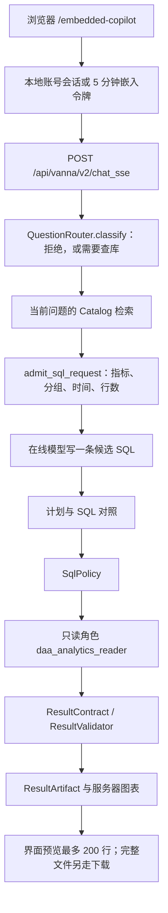

# 产品请求架构 v1

> **状态：** 当前在线路径。本地 Adapter 不在这条路径上。  
> **日期：** 2026-10-08

页面是 `http://127.0.0.1:32013/embedded-copilot`。默认回答模型是 SiliconFlow 上的在线模型。`adapter_best` 只存在于离线评测。

身份由服务端解析。请求体里的 `user_id` 和角色不会被接受；产品身份解析器也不接受旧演示角色 cookie。

会话存在 `app.conversations`，带 `workspace_id` 与 `state_version`。「清空分析上下文」去掉指标、时间和当前结果引用，保留聊天记录。超预算时才写带消息范围的历史摘要，摘要不能当指标或 SQL。策略把查询收到 1,000 行时多读一行判断截断；正好 1,000 行且没有多余行视为完整。结果追问只能用已验证摘要里的数字。偏好和「保存本次分析」只供回看，页面写明偏好尚未改变展示。

本地模型如果以后接入，只能接在「在线模型写候选 SQL」那个位置，后面的策略、只读执行和结果合同不变。现在没有这条接入。
