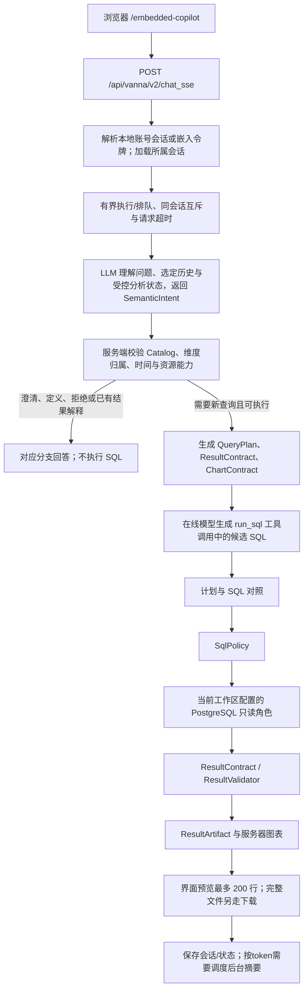

# 产品请求架构 v1

> **状态：** 当前在线路径。本地 Adapter 不在这条路径上。  
> **日期：** 2026-10-20（包含当前工作区装配、单实例容量与后台摘要；下文 Day 1 请求保留历史证据）

页面是 `http://127.0.0.1:32013/embedded-copilot`。默认回答模型是 SiliconFlow 上的在线模型。`adapter_best` 只存在于离线评测。

身份由服务端解析。请求体里的 `user_id` 和角色不作为身份或授权依据；产品身份解析器也不接受旧演示角色 cookie。

会话存在 `app.conversations`，带 `workspace_id` 与 `state_version`。「清空分析上下文」去掉指标、时间和当前结果引用，保留聊天记录。超预算时才写带消息范围的历史摘要，摘要不能当指标或 SQL。在线完整聚合按形态派生结果预算，服从进程行数、字节和超时兜底，多读一行确认是否溢出；不再统一限制 1,000 行。前端首屏仍为 200 行；模型结果证据按本轮剩余token预算组织，小结果尽量完整，大结果提供服务端统计及选定行。结果追问可以补读同一授权工件，按指标和维度的可加性计算合计或比较；分页和下载也读取该工件，不重跑SQL。模型选择解释所需证据，关键实体与数值由服务端渲染，不自行从样本推断全量。偏好和「保存本次分析」只供回看，页面写明偏好尚未改变展示。

## 2026-10-27｜结果解释引用与展示

`ObservedLlmService._explain_result()`与`BudgetedChatHandler._tool_free_answer()`的结果解释
共用`result_explanation.py`：模型只选择已有行号或指标的极值/合计引用，`render_result_answer()`
解析选择后从证据生成文字。删掉原数字集合匹配，防止把其他实体金额或行数当成当前金额。
无法使用选择时由`render_result_facts()`输出证据事实，不新增模型修复轮次；非结果类通用问答
仍走原自由回答。引用有效不等同问题理解正确或SQL业务语义正确。

`result_presentation.py`按Catalog格式化指标，保留维度键；`build_result_evidence()`提供完整
统计与预算内明细，空Top-N字典不代表业务排名限制。正文先结论；本次回答的数据依据卡片
显示实际工件列名、数据/指标版本、来源/选定/提供行数与原查询时间/筛选，初次回答和追问
都能显示，不暴露SQL或未授权结果。验收与边界见[结果解释改造记录](../../evals/results/result-explanation-20261027.md)。

本地模型如果以后接入，只能接在「在线模型写候选 SQL」那个位置，后面的策略、只读执行和结果合同不变。现在没有这条接入。

## 入口、输入输出与代码/模型分工

`src/data_analysis_agent/server.py:create_app()` 在进程启动时装配当前工作区、模型服务、Catalog、语义解释器、数据库runner、会话存储和工具，再注册HTTP路由。每条消息由 `chat_sse()` 调用 `ManagedChatHandler.handle_stream()` 管理容量与取消，再进入 `BudgetedChatHandler.handle_stream()` 执行分析，不是每次重建应用。安装入口是 `data-analysis-agent`，详见[部署说明](../deployment.md)。

| 环节 | 代码入口 | 输入 → 输出 | 谁决定 |
| --- | --- | --- | --- |
| 发消息 | `frontends/webcomponent/src/services/api-client.ts:streamChat` | 问题、conversation/request ID → HTTP JSON 请求 | 前端代码；不确定权限 |
| 流式 HTTP | `src/vanna/servers/fastapi/routes.py:chat_sse` | ChatRequest + HTTP cookies/headers → SSE 数据块 | 后端代码；不生成 SQL |
| 容量与生命周期 | `runtime_control.py:ManagedChatHandler.handle_stream` | 身份、请求ID → 有界排队/执行、同会话互斥、取消及超时清理 | 后端代码；不决定用户能问什么业务问题 |
| 身份、会话与预算 | `src/data_analysis_agent/chat_runtime.py:BudgetedChatHandler.handle_stream` | 请求与服务端认证状态 → 所属会话、run ID、预算状态 | 后端代码 |
| 语义理解与准入 | `SemanticIntentInterpreter.interpret`、`parse_semantic_intent`、`route_semantic_intent` | 原问题 + 角色可见 Catalog + 受控状态 → 校验后的指标、维度、日期、请求类型 | LLM 理解；服务端校验，不调用旧 classify/admit 语言闸门 |
| 精确 Catalog 切片 | `select_intent_catalog`、`CatalogRetriever.retrieve(metric_ids=...)` | 已校验指标与维度 ID → 表列、Join 和指标定义 | 服务端代码；不根据原问题关键词重新替换指标 |
| 查询及结果要求 | `QueryPlan.from_selection`、`ResultContract.from_selection`、`ChartContract.from_query_plan` | 已准入问题 → 指标、维度、时间、结果列与绘图约束 | 后端代码；不是离线 QuerySpec |
| SQL 候选 | Vanna Agent + `OpenAILlmService` | 受控上下文与工具定义 → `run_sql` 调用及其中的 SQL | 在线 LLM；其输出没有执行权限 |
| 审查与执行 | `TrustedRunSqlTool`、`SecurePostgresRunner`、`SqlPolicy`、`ResultValidator` | 候选 SQL → 策略决定、只读结果、合同状态 | 后端与 PostgreSQL；受控修复候选可能再次调用 LLM |
| 结果与图表 | ResultArtifact、presenter、服务端绘图 | 已验证结果 + 有效 ChartContract → 表格、图表和证据 | 后端代码；不需要模型第二次选择绘图工具 |

SSE 是这一 HTTP 请求内逐块返回的传输方式，并不代表每个数据块都调用了一次模型。回答文本是否使用 LLM 取决于具体分支；不能把所有响应都概括为模型生成。

语义解释是一次额外的在线模型调用，结构化输出只是一份理解提案，不能授予执行权限。
相对日期由服务端按 Asia/Shanghai 运算；“本月”不会因 Olist 是历史数据而偷偷改成
2018 年窗口，无数据时返回真实空结果。图表类型来自结构化意图，服务端检查轴、指标
和结果后绘图，不再要求用户必须说“折线图”，也不让模型再调用一次绘图工具。
阶段验收与残余能力限制见 [`Phase 0/1 记录`](../../plan/feature-semantic-intent-phase01.md)。
Phase 2/3 的范围回归、scope probe 与服务验收见 [`Phase 2/3 记录`](../../plan/feature-semantic-intent-phase23.md)。

## Day 1 实际请求追踪：2026-10-10

任务范围：跟踪一个固定产品问题的请求链和职责分工，修正文档，并供用户逐段阅读。输入为“按客户州统计有效订单数前五名，并生成柱状图”；输出为可回查的请求证据与学习记录。校验使用既有路由用例、一次真实在线请求和固定州订单数对照；保持默认 provider、权限与数据不变，不启动训练或离线终测。

这次通过 HTTP 客户端登录后调用当前服务的同一个 SSE 接口，**没有重新运行浏览器验收**。当前服务返回一次 SQL 查询和一个 Plotly 图表块，查询策略为 allowed、结果合同满足、ChartContract 为 valid，SSE 正常结束。

| 追踪字段 | 本次值 |
| --- | --- |
| 审阅代码基线 | `1b9565f`（不等于运行进程的版本证明） |
| 页面/服务 | `http://127.0.0.1:32013/embedded-copilot` |
| conversation_id | `day1_010eaaafce71` |
| request_id | `cd48356d-aef5-468f-9af0-9ea5385df931` |
| run_id | `55193f08-9fd4-453f-b9f1-414a0885f9f5` |
| SQL audit_id | `31913` |
| 模型 | `deepseek-ai/DeepSeek-V4-Flash` |
| dataset / metric version | `olist-kaggle-v2-2026-08-03` / `0.3-proposal` |
| Router | `answerable` / `data_query` / requires_database=true |
| QueryPlan | 指标 paid_order_count，维度 customer_state，未指定时间窗口 |
| 图表 | bar；x=customer_state，y=paid_order_count；服务端生成 |
| 最终 SQL SHA-256 | `ba7d800c3f6c64e0fdaa780b8a5db16ad11622a4d287f3f4515e6af4168ebc84` |

五行返回值及顺序与既有固定场景的 Gold 一致，最终 SQL LIMIT 为 5。既有路由/脚本定向测试为 `3 passed, 3 deselected`。这只能证明本次固定场景通过，不是在线准确率，也不是所有业务问题均正确。

原始 SSE 与查询审计副本仅保存在仓库外：`/disk2/gengnan/data-analysis-agent-data/evals/day1-request-trace-4OupjSaN/`，分别为 `response.sse`、`run-evidence.json`；脱敏核验字段在 `safe-summary.json`。数据库本身也保留关联的 run/query audit。一开始临时校验脚本按 SQL 列名找 preview 数据未命中，随后复用 `tests/test_w4_04_product_demo.py` 的既有解析函数核验中文展示列，没有重发模型请求。

审阅边界：本次 QueryPlan 的 `top_n` 为空，不能据此称“前五”已完整冻结进计划。本次 SQL 与返回行数实际正确；排行数量的结构化约束覆盖应在后续 QueryPlan 审阅中核对。

Day 1 的学习进度记录在 [`../learning/agent-project-walkthrough-v1.md`](../learning/agent-project-walkthrough-v1.md)。用户已完成入口及 Router 复述，当前进入 QueryPlan 与模型上下文小段；完整链路复述尚未完成，Day 1 不标记完成。

## 2026-10-19｜五项流程重复与结果预算审计

针对一次请求中可能重复审查、展示不可信结果和预算数字易混淆的问题，完成了五项最小修复：

1. 语义路由的 `QueryPlan.preflight()` 估算通过 `QuestionRoute.preflight_estimated_rows` 传给
   `QueryPlan.from_selection()`，在线语义路径只计算一次；离线/旧路由没有该估算时，仍在计划边界
   计算一次，避免在线重复计算。
2. `ContextBudgetFilter` 只投影 `AnalysisContextBuilder` 已选定的消息范围，不再在同一请求里再次
   调用语义压缩器。完整请求预算检查仍负责发现系统提示、工具轨迹和输出预留造成的总量超限。
3. `ResultValidator` 的 `degraded` 结果仍可在界面展示，但 `TrustedRunSqlTool` 会移除模型侧 CSV
   回退内容并标记 `result_answer_blocked`；预算中间件拒绝后续数字结论，避免把不完整形状当成可信结果。
4. `ResultBudget.as_metadata()` 的严格计划/合同字段保持不变；新增仅用于审计的 `as_evidence()`，
   明确区分进程行数上限、查询结果行数上限、前端预览行数、模型摘要行数、字节上限和超时。
5. 在线组合根要求注入 `SemanticIntentInterpreter`；`QuestionRouter.classify/admit_sql_request` 只
   保留给离线/定向测试，不再能被生产入口无意间当作默认语义路由。

定向 Python 回归为 **228 passed、28 skipped**；新增覆盖预检复用、二次压缩不重复执行、degraded
结果禁止数字回答、分层预算证据和在线旧路由组合拒绝。定向 Ruff 通过。使用最新代码重启
`data-analysis-agent-m4`（`http://127.0.0.1:32013/embedded-copilot`）后，Playwright + SSE 回归
为 **7 passed、13 deselected**，覆盖嵌入壳、结果预览、移动端布局和多轮澄清。

## 2026-10-19｜拒答与流式展示的先后关系

`after_llm_response()` 在模型流结束后才运行，单靠它替换回答仍可能先泄漏候选文本。
现在 `LlmMiddleware.should_stream_response(request)` 默认允许增量展示；
`BudgetSafetyMiddleware` 复用 `_rejection_response(usage)` 的现有判断，在已知不可信状态下返回 false。
`Agent._handle_streaming_response()` 此时只收集模型文本、工具调用和 usage，先经过最终中间件，
再由原回答路径展示安全文本。正常回答仍即时显示，不增加一套业务准入规则。

覆盖状态为工具预算耗尽、`result_answer_blocked`、SQL 修复失败和结果校验失败。
这不是对所有生成文字的语义证明。测试既检查全部 rich/simple/SSE 事件，也在浏览器观察中间 DOM；
不能仅检查最终回答已被替换。相关回归与真实三轮追问证据见
[产品完善计划第一阶段](../../plan/process-agent-product-readiness-v1.md#implementation-phase-1)。

## 2026-10-19｜产品质量审查后的结果与单位说明

本轮只调整已复现的行为：全空指标可以解释无可用值，但不进入可信数字回答；完整在线品类
预算包含一个 NULL 分组，共74行，历史离线协议不改。图表分类 NULL 仅在绘图副本标为
“（空值）”，不删组、不改指标，数值/时间空值仍不能绘图。Catalog 明确比例为0–1，在线
履约天数按连续秒数换算天数后平均，避免截去不足一天的部分。语义解释提示仍由模型判断新
分析是否缺指标，没有重新引入语言关键词闸门。

质量证据为 [60场景报告](../../evals/results/product_release_dev_v1.md)。这次也发现同维度多值
IN 的误拦截和半年度比较未真正完成，均保留失败；结果合同通过仍不能替代独立业务核对。
