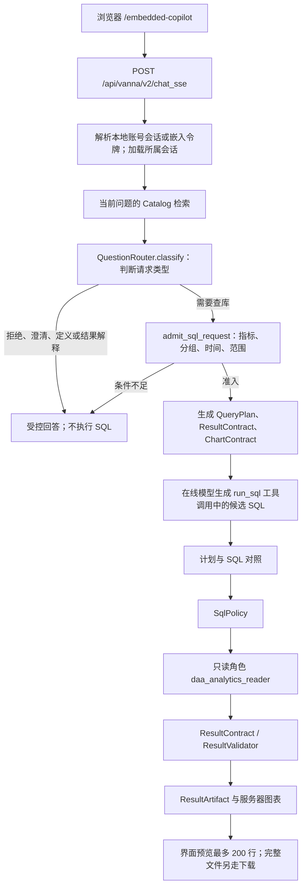

# 产品请求架构 v1

> **状态：** 当前在线路径。本地 Adapter 不在这条路径上。  
> **日期：** 2026-10-10（按当前代码校正顺序，并补充 Day 1 实际请求证据）

页面是 `http://127.0.0.1:32013/embedded-copilot`。默认回答模型是 SiliconFlow 上的在线模型。`adapter_best` 只存在于离线评测。

身份由服务端解析。请求体里的 `user_id` 和角色不作为身份或授权依据；产品身份解析器也不接受旧演示角色 cookie。

会话存在 `app.conversations`，带 `workspace_id` 与 `state_version`。「清空分析上下文」去掉指标、时间和当前结果引用，保留聊天记录。超预算时才写带消息范围的历史摘要，摘要不能当指标或 SQL。策略把查询收到 1,000 行时多读一行判断截断；正好 1,000 行且没有多余行视为完整。结果追问只能用已验证摘要里的数字。偏好和「保存本次分析」只供回看，页面写明偏好尚未改变展示。

本地模型如果以后接入，只能接在「在线模型写候选 SQL」那个位置，后面的策略、只读执行和结果合同不变。现在没有这条接入。

## 入口、输入输出与代码/模型分工

`examples/trusted_olist_web_demo.py:create_app()` 在进程启动时装配模型服务、Catalog、Router、数据库 runner、会话存储和工具，再注册 HTTP 路由。每条消息到来时，由 `chat_sse()` 调用已经装配好的 `BudgetedChatHandler.handle_stream()`，不是每次重新创建整个应用。

| 环节 | 代码入口 | 输入 → 输出 | 谁决定 |
| --- | --- | --- | --- |
| 发消息 | `frontends/webcomponent/src/services/api-client.ts:streamChat` | 问题、conversation/request ID → HTTP JSON 请求 | 前端代码；不确定权限 |
| 流式 HTTP | `src/vanna/servers/fastapi/routes.py:chat_sse` | ChatRequest + HTTP cookies/headers → SSE 数据块 | 后端代码；不生成 SQL |
| 身份、会话与预算 | `src/data_analysis_agent/chat_runtime.py:BudgetedChatHandler.handle_stream` | 请求与服务端认证状态 → 所属会话、run ID、预算状态 | 后端代码 |
| 指标检索与路由 | `CatalogRetriever.retrieve`、`QuestionRouter.classify/admit_sql_request` | 当前问题 + Catalog + 受控状态 → 指标选择、请求类型、准入决定 | 规则代码；无指标匹配时可调用受约束的 LLM grounder |
| 查询及结果要求 | `QueryPlan.from_selection`、`ResultContract.from_selection`、`ChartContract.from_query_plan` | 已准入问题 → 指标、维度、时间、结果列与绘图约束 | 后端代码；不是离线 QuerySpec |
| SQL 候选 | Vanna Agent + `OpenAILlmService` | 受控上下文与工具定义 → `run_sql` 调用及其中的 SQL | 在线 LLM；其输出没有执行权限 |
| 审查与执行 | `TrustedRunSqlTool`、`SecurePostgresRunner`、`SqlPolicy`、`ResultValidator` | 候选 SQL → 策略决定、只读结果、合同状态 | 后端与 PostgreSQL；受控修复候选可能再次调用 LLM |
| 结果与图表 | ResultArtifact、presenter、服务端绘图 | 已验证结果 + 有效 ChartContract → 表格、图表和证据 | 后端代码；不需要模型第二次选择绘图工具 |

SSE 是这一 HTTP 请求内逐块返回的传输方式，并不代表每个数据块都调用了一次模型。回答文本是否使用 LLM 取决于具体分支；不能把所有响应都概括为模型生成。

## Day 1 实际请求追踪：2026-10-10

任务范围：跟踪一个固定产品问题的请求链和职责分工，修正文档，并供用户逐段阅读。输入为“按客户州统计有效订单数前五名，并生成柱状图”；输出为可回查的请求证据与学习记录。校验使用既有路由用例、一次真实在线请求和固定州订单数对照；保持默认 provider、权限与数据不变，不启动训练或离线终测。

这次通过 HTTP 客户端登录后调用当前服务的同一个 SSE 接口，**没有重新运行浏览器验收**。当前服务返回一次 SQL 查询和一个 Plotly 图表块，查询策略为 allowed、结果合同满足、ChartContract 为 valid，SSE 正常结束。

| 追踪字段 | 本次值 |
| --- | --- |
| 审阅代码基线 | `1b9565f`（不等于运行进程的版本证明） |
| 页面/服务 | `http://127.0.0.1:32013/embedded-copilot` |
| conversation_id | `day1_010eaaafce71` |
| request_id | `cd48356d-aef5-468f-9af0-9ea5385df931` |
| run_id | `55193f08-9fd4-453f-b9f1-414a0885f9f5` |
| SQL audit_id | `31913` |
| 模型 | `deepseek-ai/DeepSeek-V4-Flash` |
| dataset / metric version | `olist-kaggle-v2-2026-08-03` / `0.3-proposal` |
| Router | `answerable` / `data_query` / requires_database=true |
| QueryPlan | 指标 paid_order_count，维度 customer_state，未指定时间窗口 |
| 图表 | bar；x=customer_state，y=paid_order_count；服务端生成 |
| 最终 SQL SHA-256 | `ba7d800c3f6c64e0fdaa780b8a5db16ad11622a4d287f3f4515e6af4168ebc84` |

五行返回值及顺序与既有固定场景的 Gold 一致，最终 SQL LIMIT 为 5。既有路由/脚本定向测试为 `3 passed, 3 deselected`。这只能证明本次固定场景通过，不是在线准确率，也不是所有业务问题均正确。

原始 SSE 与查询审计副本仅保存在仓库外：`/disk2/gengnan/data-analysis-agent-data/evals/day1-request-trace-4OupjSaN/`，分别为 `response.sse`、`run-evidence.json`；脱敏核验字段在 `safe-summary.json`。数据库本身也保留关联的 run/query audit。一开始临时校验脚本按 SQL 列名找 preview 数据未命中，随后复用 `tests/test_w4_04_product_demo.py` 的既有解析函数核验中文展示列，没有重发模型请求。

审阅边界：本次 QueryPlan 的 `top_n` 为空，不能据此称“前五”已完整冻结进计划。本次 SQL 与返回行数实际正确；排行数量的结构化约束覆盖应在后续 QueryPlan 审阅中核对。

Day 1 的学习进度记录在 [`../learning/agent-project-walkthrough-v1.md`](../learning/agent-project-walkthrough-v1.md)。当前仅进入第一小段，用户尚未完成代码复述，Day 1 不标记完成。
