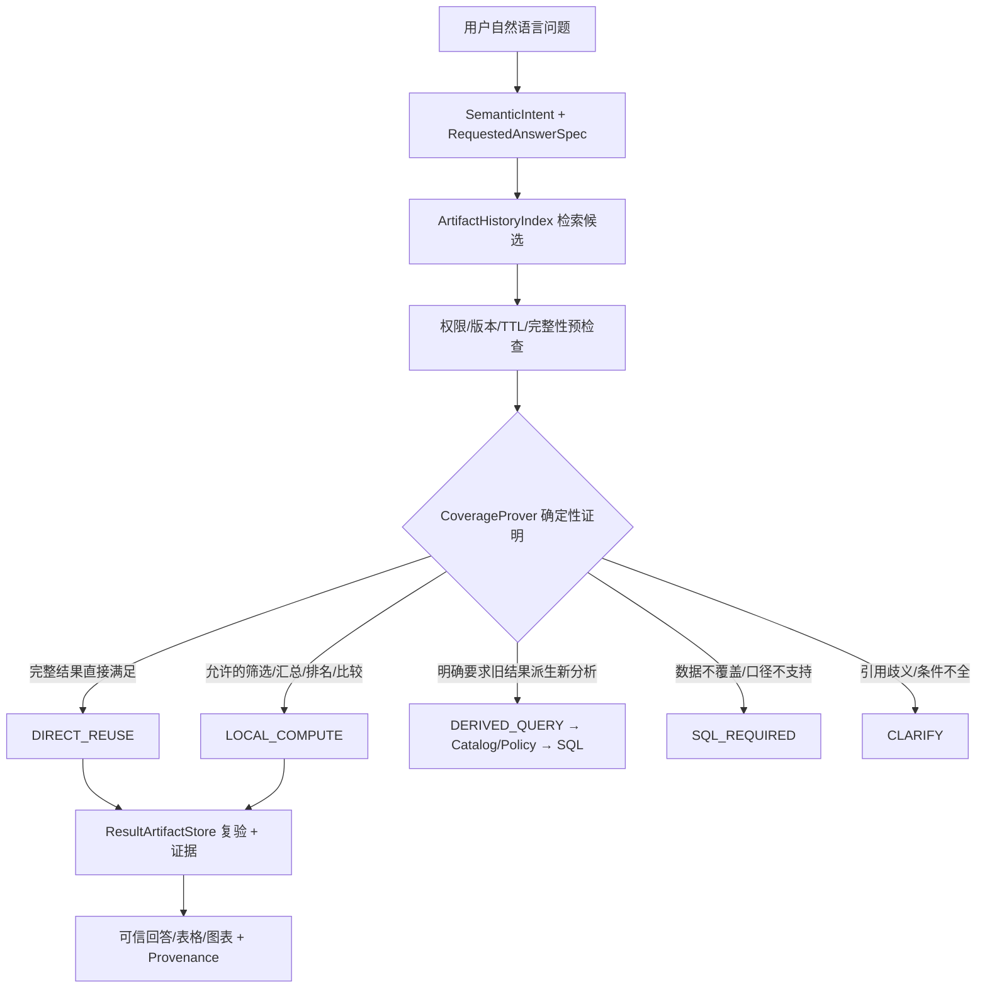

# data-analysis-agent：历史 Artifact 智能复用与上下文隔离方案 V2

> 状态：**原始设计参考**。单Artifact实现范围、代码与边界见[实施说明](architecture/historical-artifact-reuse-v2.md)，测试进度见`PROJECT.md`；本文中的P2与后续评测建议不代表已经完成。依据 `GengNSCUTer/data-analysis-agent` 的代码梳理。
> 本版与 V1 的区别：从“用户显式指定第 N 张表才能回看”升级为“**用户任意自然语言 Query → 自动检索历史可信结果 → 确定性证明结果是否足够 → 本地计算或受约束 SQL**”。
> 设计目标：降低重复 SQL、提高多轮分析连续性，同时坚持可信数值、数据权限、版本与上下文隔离。

## 0. 核心结论

不建议实现成“向量检索到相似的历史问题就直接复用 CSV”。语义相似不等于查询结果能够回答新问题。正确方案是：

1. **语义理解**：LLM / SemanticIntentInterpreter 将用户问题解析成结构化的 `RequestedAnswerSpec`（指标、维度、筛选、时间、粒度、所需运算、完整性要求）。
2. **历史候选检索**：在会话允许的 ArtifactHistoryIndex 中做元数据过滤、语义排序，选出最多 K 个候选，不把完整 CSV 塞入提示词。
3. **确定性能力判定**：服务端检查每个候选的语义口径、数据覆盖范围、权限、版本、完整性、排序和聚合可行性，给出**可证明的覆盖证据**；LLM 的“可以复用”判断不能作为最终授权。
4. **执行决策**：`DIRECT_REUSE` / `LOCAL_COMPUTE` / `DERIVED_QUERY` / `SQL_REQUIRED` / `CLARIFY`。只有前两种直接读取 Artifact，不访问业务数据库。
5. **状态隔离**：只读历史结果不会改变当前 AnalysisState；明确要求“基于旧分析修改并重新查”才派生新的 QueryPlan。
6. **结果审计**：回答绑定 source artifact、计算操作、原始查询范围、版本、行数与计算证据；不能把历史摘要当作数值来源。



## 1. 当前代码的基础与边界

| 模块 | 当前已有 | V2 需要新增 |
|---|---|---|
| `AnalysisState` / `WorkingMemory` | 当前任务、`previous_result_artifact`、结构化条件 | 保持活动状态职责，不塞入历史 CSV |
| `ExecutionMemory.reuse_decision()` | **严格等价 scope** 才复用 | 新增可证明的“覆盖/可计算”关系，不放宽原函数的安全语义 |
| `ResultInspection` / `analyze_result()` | rows、sum、compare、rank、trend、share、distribution、threshold 等 | 指定任一授权 Artifact；增加覆盖证明和算子前置条件 |
| `ResultArtifactStore` | 完整 CSV、Manifest、SHA-256、用户/工作区隔离、分页、TTL | 历史索引、固定 expires_at、跨进程生命周期协调 |
| `AnalysisContextBuilder` | task_id、版本、history_start_index、增量摘要 | 有界候选结果卡片；摘要只帮助理解意图，不作为数据证据 |
| `SemanticIntentInterpreter` | 解析意图、状态补丁、最近结果引用 | 独立输出 RequestedAnswerSpec 和历史引用提示 |
| `ResultReference` | 最近结果的排名实体解析 | 对任一授权历史 Artifact 执行实体解析 |
| `PostgresConversationStore` | 会话归属与 state_version 乐观锁 | 成功结果的索引提交、编辑回退撤销、删除会话清理 |

**当前 `reuse_decision` 的等价比较涵盖 workspace、dataset/metric version、metric_ids、dimensions、filters、time_range、time_grain、comparison_baseline、top_n、result_shape。** 这保证安全，但会错过“已有按月结果可汇总季度”“已有全州结果可筛选 CA”等机会。V2 在其前面增加独立的覆盖证明器，不应直接删除等价检查。

## 2. 用户体验：不需要说“第几张表”

| 新 Query | 历史结果 | 判定 | 行为 |
|---|---|---|---|
| “第一名比第二名高多少？” | 2024 各州销售额 Top10 | LOCAL_COMPUTE | 从完整 CSV 取前两名，服务端计算百分比 |
| “把销售额改成柱状图” | 同范围销售额结果 | DIRECT_REUSE | ChartContract 验证并换图，无 SQL |
| “2024 年 CA 的销售额是多少？” | 2024 各州销售额完整分组 | LOCAL_COMPUTE | 在可信行中筛选 CA；前提是 CA 确实在覆盖范围内 |
| “2024 年 Q1 各月销售额合计？” | 2024 全部月份销售额，且指标可加 | LOCAL_COMPUTE | 按完整月份聚合；不查询数据库 |
| “2024 年各州订单量？” | 只有各州销售额 | SQL_REQUIRED | 缺少订单量指标 |
| “2024 年所有州销售额总额？” | 只有 Top10 | SQL_REQUIRED | Top10 不覆盖全部州，不能求业务总额 |
| “2024 年每笔订单的销售额？” | 只有按州汇总 | SQL_REQUIRED | 不能从粗粒度结果恢复订单级明细 |
| “2024 年每月独立用户数加总？” | 只有每月 distinct 用户数 | SQL_REQUIRED | distinct 用户数通常不可跨月相加 |
| “上次那个增长率再看看” | 多个不同口径的增长率结果 | CLARIFY | 不能按相似度擅自选一个 |

**注意**：2024 是示例年份，不代表 Olist 实际业务库具有该年份数据。

## 3. 数据模型：ArtifactHistoryIndex 与 QueryCapability

建议 PostgreSQL 新增 `app.result_artifacts`，保存：

- **归属**：`artifact_id`, `user_id`, `workspace_id`, `conversation_id`, `context_epoch`；默认只在当前会话内自动复用。
- **来源**：`task_id`, `run_id`, `source_message_index`, `result_ordinal`, `parent_artifact_id`。
- **查询语义**：规范化 `metric_ids`, `dimensions`, `filters`, `time_range`, `time_grain`, `top_n`, `result_shape`, `query_plan_fingerprint`。
- **结果能力**：`result_columns`, `metric_semantics`, `additive_metric_ids`, `grain`, `ordering`, `row_count`, `result_complete`, `population_coverage`, `time_coverage`, `null_policy`。
- **版本和权限**：`dataset_version`, `metric_version`, `catalog_version`, `permission_scope_fingerprint`, `validation_status`。
- **生命周期**：`status`, `created_at`, `expires_at`, `csv_sha256`, `csv_bytes`, `last_access_at`。

`QueryCapability` 应由**已审计的 QueryPlan、ResultContract、ResultValidator 和真实 Manifest**产生，不能让模型凭 SQL 文本自由宣称“结果完整”。

规范化查询范围需统一时间半开区间 `[start, end)`、过滤器顺序、维度别名、指标 ID、排序方向、TopN 语义、币种/单位、指标版本。不要仅靠自然语言标题或文本 embedding 判断覆盖。

**索引与访问**：建立 `(user_id, workspace_id, conversation_id, context_epoch, status, created_at DESC)` 的候选索引；`artifact_id` 唯一；按会话的 `result_ordinal` 唯一。历史目录的摘要可以进入 LLM，但 `artifact_id` 不能作为读取授权凭证。

## 4. 结构化用户需求 RequestedAnswerSpec

建议新增 `artifact_reuse_spec.py`：

```python
class RequestedAnswerSpec(BaseModel):
    metric_ids: tuple[str, ...]
    dimensions: tuple[str, ...]
    filters: tuple[QueryFilter, ...]
    time_range: DateRange | None
    time_grain: str | None
    operation: Literal[
        "rows", "overview", "filter", "sum", "compare", "rank",
        "trend", "period_compare", "share", "distribution", "chart"
    ]
    top_n: int | None
    requires_full_population: bool
    explicit_history_ref: str | None = None
    mutation_intent: Literal["inspect", "derive_query"] = "inspect"
```

实际落地时应复用项目现有 `SemanticIntent`、`ResultInspection`、`StatePatch` 类型，避免重复定义不同语义的字段。上面是逻辑示例，不是直接可复制运行的补丁。

语义解释时先从当前 AnalysisState 继承已确认条件，再根据用户本轮修改构建目标需求；但**历史候选的查询范围不能反向污染当前任务**。历史摘要只可用于“用户大概指哪份分析”的检索提示。

## 5. 两阶段候选检索：先硬约束，再软排序

### 5.1 第一阶段：元数据硬过滤

- 必须属于已认证 `user_id` + 当前 `workspace_id` + 当前 `conversation_id`，且位于允许的 `context_epoch`；跨会话默认不自动引用。
- `status=READY`，未过期、未撤销、未回退删除，validation 为 valid。
- 当前角色仍具备对应指标、维度、行级数据访问权限；权限变化时旧结果不能绕过新权限。
- 指标/数据集/Catalog 版本符合策略；如果底层数据更新而版本未变，需要单独的新鲜度策略或快照语义，不能把旧结果称为“实时”。
- 优先筛选所需指标、时间、粒度及结果列；不足时直接淘汰。

### 5.2 第二阶段：候选排序

对最多 K=5～10 个候选按以下因素排序：

1. 结构化查询覆盖程度（权重最高）。
2. 所需本地计算步骤数量及成本。
3. 最近使用时间、当前任务相关性、明确的用户指代。
4. 语义相似度（可用关键词/向量/LLM rerank，但**只能排序，不能授权**）。
5. 结果新鲜度。

**不要**把全部历史聊天或 CSV 注入模型；只提供例如“2024 各州销售额、10 行、Top10、结果创建时间”的小卡片。

## 6. CoverageProver：关键的确定性安全边界

建议新增 `artifact_coverage.py`，返回带理由的结构化决策：

```python
class CoverageDecision(BaseModel):
    mode: Literal["DIRECT_REUSE", "LOCAL_COMPUTE", "DERIVED_QUERY", "SQL_REQUIRED", "CLARIFY"]
    artifact_id: str | None
    verified_predicates: tuple[str, ...]
    missing_requirements: tuple[str, ...]
    operation_plan: tuple[dict, ...]
    confidence: Literal["proven", "unproven"]
```

### 6.1 必须验证的前置条件

| 维度 | 允许复用的条件 | 禁止或转 SQL 的情况 |
|---|---|---|
| 指标 | 结果包含同一 metric_id 和版本 | 只有销售额，用户要订单量 |
| 时间 | 源结果完整覆盖目标期间，且有可筛选时间列 | 只有全年合计，用户要每月趋势 |
| 过滤 | 目标过滤字段在结果中，且结果对目标人群完整覆盖 | 只有 Top10，目标州不在结果中，不能把缺失当 0 |
| 粒度 | 源结果粒度不粗于目标；可合法 roll-up | 只有州级，用户要订单明细 |
| 聚合 | sum 仅用于可加指标；平均值需分子分母；distinct 需可合并状态 | 直接相加平均数、去重人数、比例 |
| 排名/TopN | 排名源范围和排序已验证，比较源 TopN 内实体可用 | 用 Top10 求全市场总量或重新计算全量 Top20 |
| 权限 | 现时用户仍可访问源数据及结果 | 历史结果原来可看但当前权限被撤销 |
| 版本/完整性 | 当前要求与结果快照语义兼容、哈希有效 | 文件损坏、版本不匹配、TTL 过期 |
| 语义 | 单位、币种、时间边界、空值规则一致 | 口径不同但文本相似 |

**关键例子**：按州完整汇总的销售额可以筛选一个州；但如果 CSV 是 Top10，就只能回答“这十个州内”的问题，不能回答“所有州”或断言没出现的州销售额为 0。

### 6.2 不支持的情况必须 fail closed

- `SQL_REQUIRED`：数据不够、不能证明完整性、缺指标、需要更细粒度。
- `CLARIFY`：用户的指代或比较基期不明确。
- 不能把 LLM 判断“应该够用”作为执行许可；必须有 `verified_predicates` 的确定性证据。
- 对非可加指标、分母缺失、TopN 截断、join 口径和数据版本冲突，默认转 SQL，而不是凭经验推断。

### 6.3 多 Artifact 联合

MVP **不建议**自动跨 Artifact 做 join、相减或拼接。两份结果即使都来自 2024，也可能采用不同的实体粒度、过滤、口径、权限或快照时点。后续若支持，必须证明 join key 唯一、时间和版本一致、无重复放大，并有可审计的多源血缘。

## 7. 运行链路与状态隔离

```python
async def answer_with_reuse(user, conversation, question):
    spec = await semantic_interpreter.parse_requested_answer(question)
    candidates = await history_index.search_authorized(user, conversation, spec, limit=8)
    decisions = [coverage_prover.prove(spec, item) for item in candidates]
    decision = choose_best_proven(decisions)
    if decision.mode in {"DIRECT_REUSE", "LOCAL_COMPUTE"}:
        artifact = await store.verify_and_open(decision.artifact_id, user, conversation)
        evidence = await execute_allowed_local_ops(artifact, decision.operation_plan)
        return answer_with_grounded_evidence(evidence, provenance=decision)
    if decision.mode == "CLARIFY":
        return ask_for_missing_scope(decision.missing_requirements)
    return await governed_sql_pipeline(spec)  # 原 Catalog/QueryPlan/Policy/ResultValidator
```

此为架构伪代码，具体异步接口应按现有项目适配。

**状态更新规则**：

- `inspect`：只读历史 Artifact，不修改当前 `AnalysisState` 的指标、时间、过滤或 `previous_result_artifact`；可以记一条“本轮引用 Artifact A”的 provenance。
- `derive_query`：用户明确说“把那个排行榜改成 2023 年”，才从历史 `query_scope` 派生新的候选 QueryPlan；必须重新 Catalog 和权限校验，成功后更新当前状态。
- 历史复用失败：不清空最近成功 Artifact，不把历史结果冒充新 SQL 结果。
- 纯历史复用也要记审计事件（source artifact、operator、scope、decision reason），便于解释为何没查库。

## 8. 上下文、摘要、编辑回退与清空

- `AnalysisContextBuilder` 继续用 `task_id`、`history_start_index`、dataset/metric version 管理当前任务上下文。
- 历史结果目录与摘要独立存储；摘要不是数值来源，历史 CSV 不进入 LLM 上下文。
- `context_epoch` 在“清空当前分析上下文”时递增；之后自动检索只看新 epoch。历史旧结果可以在用户明确打开历史列表时查看，但**不能自动参与新任务**。
- 编辑或撤销某轮消息：同步撤销该轮及后续依赖的 Artifact 引用；若有派生血缘则级联失效或要求重新验证。
- 会话删除：立即撤销本会话的索引读取权限，文件异步清理；跨会话默认不能直接复用。
- 摘要生成与覆盖位置需原子持久化，必须验证消息水位和任务 scope；并发失败保留原摘要和原覆盖位置。

## 9. 生命周期、存储一致性与权限

- 建议生命周期：`PENDING → READY → EXPIRED / INVALID / REVOKED → PURGED`。
- `expires_at` 以创建/明确延长保留操作确定，不能因更新图表 Manifest 的 mtime 而无意延长。
- 保存分析摘要不等于永久保存 CSV；“保存数据快照”需要显式保留策略、配额、到期日。
- 写入采用：临时 CSV → 校验哈希 → 原子替换文件 → 数据库事务提交 READY 索引与会话状态 → 对外可见；DB 失败留下的文件由孤儿清理回收。
- 每次读取再次校验 user、workspace、conversation、当前权限、版本、TTL、Manifest/SHA-256；不要只依赖 Artifact ID。
- 多 Worker 下进程内 `_busy` 不足以保护清理与下载；需要跨实例租约或集中式清理协调。
- 用户访问权限被收回后，历史 CSV 不应成为绕过业务授权的后门。对角色/行级权限变更必须重新判定，或直接使旧 Artifact 失效。

## 10. 代码改造清单（建议）

**新增**：

- `artifact_history.py`：持久索引、授权查询、状态转换、结果来源关系。
- `artifact_reuse_spec.py`：统一用户需求的结构化表示。
- `artifact_coverage.py`：确定性覆盖证明与拒绝理由。
- `artifact_reuse_planner.py`：候选检索、排序、计算计划和 SQL 回退。
- `artifact_reuse_audit.py`：复用/回退/成本/命中率审计（也可复用现有审计系统）。

**修改**：

- `semantic_intent.py`：增加需求结构与历史引用候选提示。
- `chat_runtime.py`：在 SQL 生成前插入 ReusePlanner；不改变已有 SQL fail-closed 边界。
- `result_analysis.py`：以授权完整 DataFrame 执行可证明的算子计划；复用已有运算逻辑。
- `result_reference.py`：可指定历史 Artifact 的排名/实体解析。
- `analysis_context.py`：有界候选摘要，绝不注入 CSV 全文。
- `conversation_store.py`：事务性索引提交、编辑回退、删除清理。
- `result_artifact_store.py`：固定 TTL、索引驱动 GC、跨实例读写保护。
- `server.py`：历史列表、授权分页/下载/换图接口。

## 11. 测试矩阵（上线前必须通过）

| 场景 | 预期 |
|---|---|
| A 销售额 Top10 → B 订单量 → 问 A 第一/第二名差异 | 自动找到 A，本地计算，无 SQL |
| 已有完整月销售额 → 问季度合计 | 可加、时间覆盖完整时本地聚合 |
| 已有州级销售额 → 问订单级明细 | 转 SQL，不凭空细化 |
| 只有 Top10 → 问全部州总额 | 转 SQL，不能把 Top10 视为总体 |
| 已有月度 distinct 用户数 → 问年度 distinct 用户数 | 转 SQL，不能直接相加 |
| 语义相似但指标不同 | 不复用 |
| 语义相似但年份不同 | 不复用，除非源结果明确覆盖目标年份且可筛选 |
| 用户 A 猜 B 的 Artifact ID | 拒绝 |
| 同用户不同会话 | 默认不自动检索 |
| 当前权限被撤销 | 旧 Artifact 拒绝读取 |
| 清空上下文后问“上次那个” | 不自动恢复旧 epoch |
| 编辑回退/删除会话 | 索引撤销且后续无法读取 |
| CSV 篡改、Manifest 不一致、过期 | 拒绝复用，转 SQL 或提示 |
| 多个候选都匹配但快照口径不同 | 澄清或保守转 SQL |
| 两个并发请求写索引 | 不重复、乐观锁正确、无孤儿 READY |
| 索引写入失败但 CSV 成功 | 不暴露未提交结果，后台清理 |
| 只读历史结果后继续当前任务 | AnalysisState 未被旧结果污染 |

## 12. 评测与指标

建立约 80～150 条真实多轮任务测试集，标注每轮的 `reuse / local_compute / SQL / clarify` 金标准。**最重要的指标不是复用率，而是错误复用率**：

- `unsafe_reuse_rate`：错误复用/越权复用比例，必须为 0（测试集内）。
- `reuse_precision`：被判定可复用的请求中，真正满足语义口径的比例。
- `avoidable_sql_rate`：本可由历史结果回答却仍查 SQL 的比例（越低越好）。
- `sql_saved_count`、平均 SQL 延迟降低、P95 响应时间、LLM token 开销。
- `fallback_reason_distribution`：缺指标、缺时间、TopN 不完整、非可加、过期、权限等。
- `artifact_stale_read_rate`、清理滞后、孤儿文件数。

建议采用 shadow mode：先只记录 Planner 的判断，不改变现有执行；对照人工标注后，再开放严格等价复用与少量确定性算子，逐步扩大覆盖。

## 13. 分期实施

### P0（优先 MVP）
1. 建历史 Artifact 索引和事务性来源绑定。
2. 建 `RequestedAnswerSpec` 和 Metadata-first CandidateRetriever。
3. 实现 **严格等价、已返回行筛选、TopN 内比较、换图** 四类确定性覆盖证明。
4. 接入 `ResultArtifactStore` 的授权读取及 `ResultAnalysis` 本地计算。
5. 增加 30～50 条多轮正负例，先 shadow mode，再小流量开启。

### P1（增强复用）
1. 时间子区间过滤与合法 roll-up（仅可加指标）。
2. 增加完整性证明、非可加指标的充分统计量约束。
3. `context_epoch`、编辑回退、会话删除的索引同步。
4. 固定 `expires_at`、孤儿文件 GC、权限变更失效。
5. 监控与可解释的复用原因。

### P2（工程化）
1. 跨实例生命周期租约、快照保存、配额。
2. 更丰富的历史候选检索和用户可见引用解释。
3. 可选多 Artifact 运算，但必须先实现联合口径证明。

## 14. 与旧 V1 方案的关系

V1 解决“**历史结果能被安全找回**”；V2 进一步解决“**即使用户不说第几张表，系统也能主动判断哪份历史结果足以回答当前问题**”。

**不可混淆的边界**：历史结果自动复用是一种受控的 Query Optimization，不是用向量相似度替代 SQL；任何无法证明覆盖的情况都应走原有 Catalog → QueryPlan → SQL Policy → ResultValidator 链路。

## 15. 源码参考

- https://github.com/GengNSCUTer/data-analysis-agent/blob/main/src/data_analysis_agent/execution_memory.py
- https://github.com/GengNSCUTer/data-analysis-agent/blob/main/src/data_analysis_agent/result_analysis.py
- https://github.com/GengNSCUTer/data-analysis-agent/blob/main/src/data_analysis_agent/semantic_intent.py
- https://github.com/GengNSCUTer/data-analysis-agent/blob/main/src/data_analysis_agent/chat_runtime.py
- https://github.com/GengNSCUTer/data-analysis-agent/blob/main/src/data_analysis_agent/analysis_context.py
- https://github.com/GengNSCUTer/data-analysis-agent/blob/main/src/data_analysis_agent/result_artifact_store.py
- https://github.com/GengNSCUTer/data-analysis-agent/blob/main/src/data_analysis_agent/conversation_store.py
